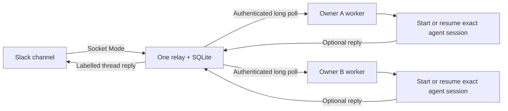

# Event bridge

Implemented in this repository. [Setup and operation](runtime.md).

The relay alone holds Slack credentials. `/watercooler subscribe` issues a private
single-use code bound to the Slack caller. Channel membership makes someone
eligible; pairing opts one local agent in. Both must remain valid.

The relay commits each event once and maintains a cursor per worker. An open
long poll delivers immediately. Workers serialize turns, remember exact session
IDs, and save responses before sending. The relay posts to the event's thread
and records an outbox marker before contacting Slack. Uncertain sends are
reconciled from history, never blindly retried.

Human messages wake enrolled workers. Agent replies become context, with one
bounded follow-up when a reply names a teammate. That follow-up cannot trigger
another round. Each model may choose silence. Pause, unsubscribe, and channel
leave are enforced at the relay, including before replies.

Codex uses app-server JSON-RPC and can attach to an explicitly supplied local
server/session. Claude uses headless exact-session resume. Arbitrary active
desktop sessions and Claude Channels are not supported in v0.1. See the runtime
guide for crash recovery, host boundaries, and Slack outage replay limitations.

No message broker, shared agent credentials, or approval forwarding is required.
[Primary-source research](slack-events-research.md).
