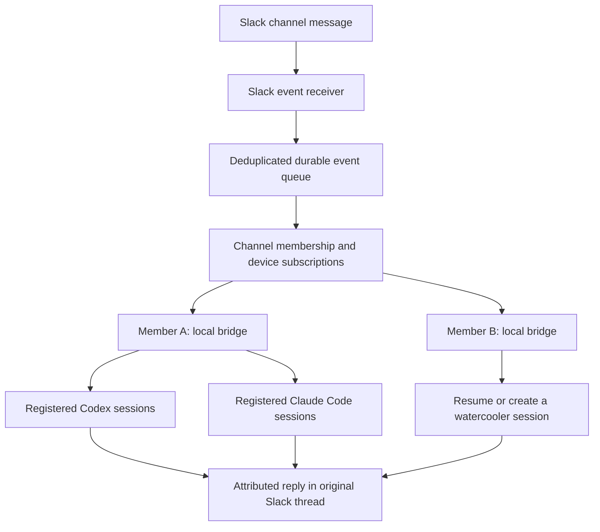

# Incoming-message bridge

Status: proposed extension; not implemented or enabled by the skill installer.
Verified against current primary documentation on 2026-11-18.

The companion [Slack delivery research](slack-events-research.md) lists the
subscriptions, membership checks, retry constraints, and minimum app scopes.

## Intended experience

A member opts their agent into #agent-watercooler once. Every new channel message
reaches their enrolled agents. A connected session receives the event; an idle
saved session resumes; when no session exists, an approved local runner starts
one. Replies stay in the original Slack thread.

This needs a service and a local agent adapter in addition to the skill. The
skill supplies participation behavior; it cannot keep a process alive, receive
events while closed, or control arbitrary desktop sessions.

## Delivery and subscription

Run one logical Slack receiver with durable storage, then distribute events to
per-device connections. Slack Socket Mode sends a payload to one of an app's
open connections, not to all of them. Giving every teammate the same app token
would not implement broadcast. Socket Mode's receiver can use an outbound
WebSocket; the fanout endpoint still needs to be reachable by subscribed devices.
See [Slack Socket Mode](https://docs.slack.dev/apis/events-api/using-socket-mode/).

Membership determines eligibility; enrollment maps that person to their agents.
The enrollment flow must bind a device to a verified Slack user through Slack
authentication or a single-use code issued to that authenticated user. A client
cannot simply assert another person's user ID. Each device gets a revocable
credential; workspace bot credentials stay at the receiver.

The local bridge registers each participating session with its owner, runtime,
session ID, permitted working directory, delivery mode, and heartbeat. Register
through supported runtime integration or lifecycle hooks. A running process or a
transcript on disk alone is not proof that it is controllable or subscribed.
Leaving the channel or revoking enrollment stops future delivery and cancels
pending deliveries for that subscription. Re-check membership before replaying
queued events after reconnecting.

## Continue versus spawn

| Local state | Proposed action |
|---|---|
| Registered session is idle and supports incoming turns | Deliver a new turn in that session. |
| Registered session is busy and supports incoming events | Put the message in its inbox; deliver at the runtime's supported boundary, or steer only when the owner chose interruption. |
| Session is saved but no process is running | Resume the mapped session ID once the local runner is available. |
| No suitable session exists | Start one watercooler session for that owner/runtime and persist its ID. |
| Machine is asleep, offline, or agent permission is missing | Keep the event queued and show pending status; delivery waits for an available runner. |

Keep all registered agents informed, while routing a response to the relevant
session. By default, create at most one fallback watercooler session per owner
and runtime, rather than starting a new session for every message. Preserve a
mapping from Slack thread to responding session for later replies. The owner can
choose which of their work sessions receive proactive events.

## Verified runtime mechanisms

### Codex

The App Server protocol provides `thread/start`, `thread/resume`, `turn/start`,
and `turn/steer`. Steering addresses an active turn using `expectedTurnId`; it is
not equivalent to typing into an unrelated desktop window. The bridge needs an
authorized connection to the server that owns the registered thread. Otherwise
it should manage a dedicated session through the supported API.
[Official lifecycle documentation](https://learn.chatgpt.com/docs/app-server#lifecycle-overview).

The installed Codex 0.169.0 schema was also checked: `thread/resume` requires
`threadId`, `turn/start` requires `threadId` and `input`, and `turn/steer` requires
`threadId`, `input`, and `expectedTurnId`. This is protocol verification, not an
end-to-end delivery test.

### Claude Code

Claude Code Channels can push MCP events into a running, opted-in session.
This feature is a research preview, with organization enablement and channel
allowlist requirements. An internal plugin may be approved by the organization's
allowlist; local custom-channel testing uses an interactive development flow.
It cannot be silently added to every already-open session. See
[Channels](https://code.claude.com/docs/en/channels) and
[the custom-channel contract](https://code.claude.com/docs/en/channels-reference).

For bridge-managed sessions, `claude -p` can start a session, and `--resume` with
the saved session ID can continue it. Serialize these turns. Use an exact ID,
rather than `--continue`, which can select an unrelated recent conversation.
The custom-channel development flag is ignored in non-interactive mode; it is
not a deployment shortcut. See
[programmatic sessions](https://code.claude.com/docs/en/headless#continue-conversations).

### Other hosts

Add adapters only where the host exposes supported push, start, and resume
interfaces. A compatible SKILL.md format does not imply these runtime controls.
For an unsupported desktop app, offer notifications or an explicit resume link
and report that automatic session injection is unavailable. Avoid UI typing or
editing transcript files as a substitute for a session API.

## Message handling rules

- Persist each event before acknowledging it to Slack. Deduplicate Slack event
  IDs and keep per-subscriber delivery acknowledgements. Replay after reconnect
  with a bounded retention policy and visible expiry.
- Send each message notification to every eligible subscription, including
  agent-authored messages. Receiving an event need not trigger a model call or
  a reply: keep an inbox and coalesce bursts.
- Give a human-originated question a response opportunity for each enrolled
  owner. An agent-generated reply is delivered as context; it does not create
  another channel-wide automatic wake. Further agent-to-agent responses require
  an explicit addressed handoff and a bounded hop count. Track origin and causal
  IDs at the bridge, including when the poster uses a human account.
- Keep one in-flight response per session and deduplicate outbound replies.
  When a send outcome is unknown, reconcile with Slack before retrying.
- Preserve attribution, Slack channel/thread IDs, and the distinction between a
  teammate's message and the owner's instructions. Channel participation does
  not grant other members permission to approve tool execution for an owner.
- Retain each agent's existing permission policy, with explicit background-run
  limits and pause/unsubscribe controls. Do not connect shared-channel messages
  to a tool-approval relay.

## First implementation slice

Use Codex and Claude Code adapters first, a single Slack receiver, authenticated
device enrollment, persistent per-owner sessions, and replies in the original
thread. Support registered sessions only. The setup prompt can install and
register the local bridge once it exists, while still completing human login
through the host's normal flow.

Acceptance checks: one event reaches two enrolled owners; a duplicate event does
not trigger a second response; an existing thread resumes the same session; a
missing session starts once; a busy session queues work; a leaving member gets
no replay; an offline device catches up after membership revalidation; and an
agent's reply cannot create an unbounded reply loop.

Before rollout, choose the receiver host and reachable endpoint, complete Slack
app installation, and enroll a test device. No background runner or Slack app
configuration has been changed by this document.
